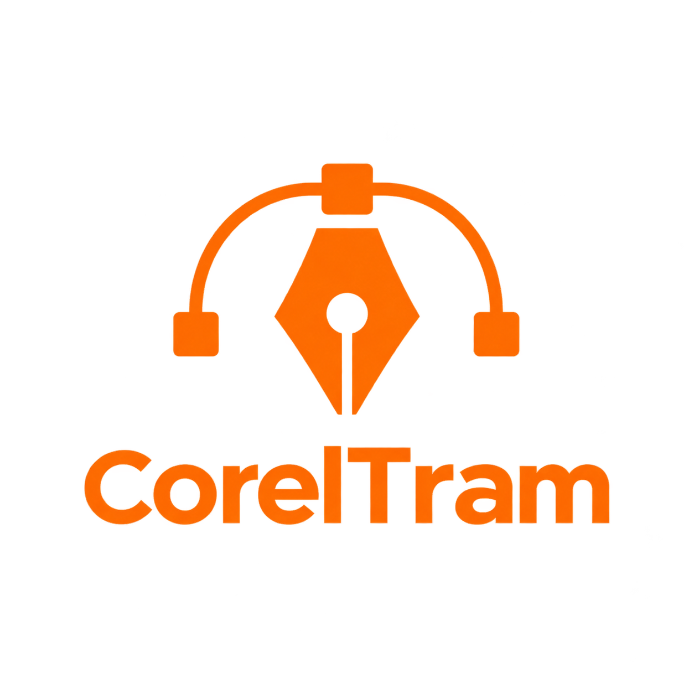

# VectorTram

<p align="center">
  
</p>

<p align="center">
  Editor de gráficos vectoriales <b>gratuito y de código abierto</b> escrito en C# con WPF.
</p>

---

> **VectorTram es un proyecto personal.** No es un producto comercial ni está afiliado a ninguna otra empresa. Nació como un proyecto de aprendizaje y como una herramienta propia para crear y editar gráficos vectoriales en Windows con una interfaz limpia y ligera.

## Características

- **Herramientas de dibujo:** rectángulo, elipse, línea, lápiz (trazado libre), pincel y pluma vectorial (curvas Bézier).
- **Texto** editable en el lienzo, con selección de fuente, tamaño, alineación, interlineado y espaciado.
- **Selección y transformación:** 8 tiradores de redimensión, rotación y movimiento.
- **Mesa de trabajo (pasteboard):** dibuja y coloca objetos dentro y fuera de la hoja.
- **Zoom y navegación:** acercar/alejar con la rueda o el cursor, herramienta lupa con marquesina, "ajustar a ventana" y herramienta mano.
- **Capas**: crear, listar y mostrar/ocultar.
- **Color:** paleta de colores, paleta de pantalla, mezclador RGB y degradados.
- **Estilos de trazo:** grosor, estilo de línea (sólida, guiones, puntos, guion-punto...), extremos, uniones y estilos rápidos.
- **Documentos:** varias pestañas, tamaños de hoja predefinidos y personalizados (mm, cm, in, px, pt), orientación e importación de imágenes.
- **Archivos:** guardar/abrir en formato `.vtm` (también XAML y antiguos `.ctm`), deshacer/rehacer y cuadrícula con ajuste.

## Tecnologías

- **Lenguaje:** C# (`nullable` habilitado)
- **Framework:** .NET 10 + WPF
- **IDE recomendado:** Visual Studio 2022 o superior

## Requisitos

- Windows 10 / 11
- [.NET SDK 10.0](https://dotnet.microsoft.com/) o Visual Studio con la carga de trabajo **.NET Desktop Development**

## Compilar y ejecutar

Desde esta carpeta (`VectorTram.csproj`):

```bash
dotnet build
dotnet run
```

O abre `VectorTram.csproj` en Visual Studio y pulsa **F5**.

## Atajos de teclado

| Tecla | Herramienta | Tecla | Acción |
|-------|-------------|-------|--------|
| `V` | Selección | `Ctrl + N` | Nuevo |
| `R` | Rectángulo | `Ctrl + O` | Abrir |
| `E` | Elipse | `Ctrl + S` | Guardar |
| `L` | Línea | `Ctrl + I` | Importar imagen |
| `T` | Texto | `Ctrl + Z` / `Ctrl + Y` | Deshacer / Rehacer |
| `P` | Lápiz | `Del` | Eliminar |
| `N` | Pluma | `Ctrl + +` / `Ctrl + -` | Acercar / Alejar |
| `B` | Pincel | `Ctrl + 0` | Ajustar a ventana |
| `H` | Mano | `Ctrl + W` | Cerrar pestaña |
| `Z` | Lupa | — | — |

## Estructura del proyecto

```
├── logotipo.png
├── VectorTram.csproj
├── App.xaml(.cs)          # Arranque y ventana de bienvenida
├── StartWindow.xaml(.cs)  # Pantalla de inicio / nuevo proyecto
├── MainWindow.xaml(.cs)   # Ventana principal e interfaz
├── Partials/              # Lógica dividida por áreas:
│   ├── MainWindow.Canvas.cs
│   ├── MainWindow.Shapes.cs
│   ├── MainWindow.Pen.cs
│   ├── MainWindow.Selection.cs
│   ├── MainWindow.Tools.cs
│   ├── MainWindow.Zoom.cs
│   ├── MainWindow.Colors.cs
│   ├── MainWindow.Stroke.cs
│   ├── MainWindow.Text.cs
│   ├── MainWindow.Layers.cs
│   ├── MainWindow.Properties.cs
│   └── MainWindow.Files.cs
└── Models/
    └── LayerInfo.cs
```

## Licencia

Este es un proyecto personal y de código abierto, distribuido bajo la licencia **MIT**. Puedes usarlo, estudiarlo y modificarlo libremente. Consulta el archivo [`LICENSE`](LICENSE) para más detalles.
